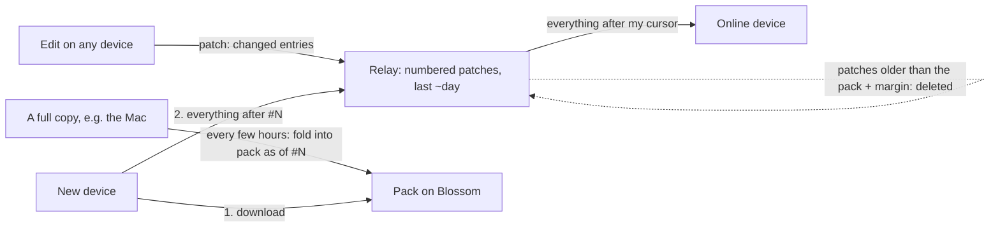

# State objects: stamped records, packs and a relay cursor

Status: **design; the record library exists (rollout step 3), the daemon
can run on records behind `GLON_RECORDS=1` and syncs them through the
harness (`harness/src/recordsync.ts`: patches, relay cursor, packs built,
announced, loaded and retired; "Record mode"), and the pack format is
implemented (rollout step 4).**
Proposed successor to the base / delta / compaction model of
`docs/state-sync.md` (which stays the contract until this ships).

## Why

A new device takes minutes to load a vault, and the time grows with the
number of objects:

- Every object is a **chain of edits** (`core/dag.odin`); its state is a
  replay of that chain. Dropping old edits needs a stand-in for them, so
  every object also has a **base** (checkpoint), and computers **compact**
  edits into new bases.
- A new device asks the relay for bases 100 objects per request
  (`HTAG_BATCH`), relay by relay, waiting for each answer (EOSE) before the
  next; then for the live deltas of those bases, again in batches; then it
  decrypts, verifies and applies every event separately. It is thousands
  of small waits and writes, not a lot of data.
- Measured on Grant's Mac (2026-10-28): 6,685 live objects, 7,748 bases
  from relays, 2,533 backfill events, 49,404 change files on disk.

At 10x the objects every one of those numbers grows 10x.

## The design in one paragraph

An object is stored as its **current state**, where every property, block
and chat message carries a **stamp** (hybrid clock time + device). Two
copies of an object merge entry by entry - the newer stamp wins - so order
and repetition do not matter and there is no history to keep. An edit is a
**patch**: just the changed entries. The relay numbers each space's events
with a **cursor**. Every few hours a full copy folds the space into a
**pack** - all records, compressed and encrypted on Blossom - "as of cursor
N", and patches older than the pack (plus a margin) are deleted. A new device
downloads the pack, then asks for "everything after N". An online device asks
for "everything after my cursor". A **fingerprint** of the space tells any
device whether it is exactly in step.



## Goals

- A new device loads any space with **one download plus one query**.
- An online device catches up with **one query per reconnect**.
- **No edit history, bases, checkpoints or compaction** to maintain.
- Same guarantees as today: end-to-end encrypted, signed by members, works
  offline, every device converges to the same state.
- Lite devices (web, iPhone) can still fetch one object without the whole
  space.

## Non-goals

- Character-level co-editing of one paragraph (no text CRDT; a paragraph is
  one entry - newer wins, as effectively today).
- Edit history or undo of other people's changes (nothing in the app uses
  the DAG for this today; confirm in the audit, phase 1).
- Files: unchanged (Blossom, `docs/state-sync.md` "Files on Blossom").

## Object records

```proto
message Stamp {
  uint64 time   = 1;   // hybrid logical clock: unix ms << 16 | counter
  uint32 device = 2;   // index into the space's device table (below)
}

message Entry {
  string key    = 1;   // property key, block id, message id
  Stamp  stamp  = 2;   // always written, even when zero
  bool   gone   = 3;   // tombstone: the entry was removed at `stamp`
  oneof body {         // a tombstone keeps an empty body of its kind
    Value       value   = 4;   // a property (existing Value message)
    BlockBody   block   = 5;
    MessageBody message = 6;
  }
}

message BlockBody {
  string   parent           = 1;   // "" = top level
  string   position         = 2;   // fractional key, sorts siblings (as pin_order)
  BlockContent content      = 3;   // existing block content (text, style, marks, ...)
  ValueMap fields           = 4;   // existing Block.fields (column width, ...)
  BlockAlign align          = 5;   // existing Block.align
  string   background_color = 6;   // existing Block.background_color
}

// Same fields as BlockBody; `content` is the existing chat block content
// (custom "chat", meta {author, ts, text, ...}).
message MessageBody { /* fields 1-6 as BlockBody */ }

message Record {
  string object_id   = 1;
  Entry  type        = 2;   // key "type": value {string_value: typeKey}
  Entry  deleted     = 3;   // key "deleted": value {bool_value}, object-level
  repeated Entry fields   = 4;
  repeated Entry blocks   = 5;
  repeated Entry messages = 6;
  int64 created_at   = 7;   // informational; merge keeps the smallest non-zero
}
```

BlockBody carries `fields`, `align` and `background_color` (not in the first
draft) because blocks have them today and a record must show the same page.

Implemented in `core/record.odin` (and `roostr-engine`), checked against the
shared vectors in `core/testdata/record_vectors/`. Details both engines fix:

- **Canonical encoding** (hashing, packs): proto3 rules (defaults omitted,
  fields in number order); entries sorted by key; every map (Value maps at
  any depth, block `fields`, custom `meta`) sorted by key, a repeated key
  keeps its last value; a tombstone's body encoded empty.
- **Merge tie**: equal stamps (never written on purpose) - the larger
  canonical Entry bytes win, so merge stays commutative.
- **View** (record → today's object JSON): live fields; blocks and messages
  form one tree, children ordered by `(position, id)`, entries whose parent
  is gone are hidden; `created_at` = the record's, else the oldest stamp;
  `updated_at` = the newest stamp, tombstones included.
- **Conversion** (`record_from_object_state`): one replay of the DAG with a
  `Replay_Hook` records, per key, the last change that wrote it; a block
  counts as a message when its content is custom `"chat"`; positions come
  from `pin_key_between` by bisection over each sibling list (short keys
  for long chats); keys removed by a change become tombstones; entries
  from a checkpoint seed get its `updated_at` and device 0. A device holding
  a base converts from it (`record_writers_replay_base`) as the store loads
  it. The `record` core method exposes this to hosts without a replay
  (`writers`, `from_changes`; changes and a legacy checkpoint, not bases).
- **Participants** (both engines, `record_participants_split` in
  `core/record.odin`, `participants_split` in `roostr-engine`): conversion
  stores a live discussion root's (custom `"discussion"`, data a
  Conversation) participants as one field entry each,
  `participant:<thread block id>:<participant>` = Int list index, stamped
  as the block, and the root keeps the rest of the Conversation with an
  empty participant list. The view joins them back - live Int entries
  under the root's prefix, ordered by `(index, id)`, re-encoded into the
  root - and hides every `participant:` field (their stamps still count for
  `updated_at`). A root whose bytes would not survive the split exactly
  (not decodable, not re-encoding to the same bytes, a participant listed
  twice or not UTF-8) stays whole. Vectors: `participants.json`.
- **Dry run** (`glon-odin records-check [objectId]`, offline, reads
  `GLON_DATA`): converts every object, views it back and compares with
  today's state. Grant's Mac, 2026-10-28: 7,334 objects, 7,325 exact; the 9
  others are design consequences - 6 type-less fragments with no create
  (`created_at` 0 today, the oldest stamp in the view), 1 empty base-only
  fragment (`updated_at` lost: no entry carries a stamp), 1 dangling child
  id (a record cannot point at a block it lacks), 1 empty-but-present block
  `fields` map (wire form only; API JSON equal). 112,872 entries, 95% stamped
  by a base seed (time = the base's `updated_at`, device 0): stamps, hence
  record hashes, depend on which base a device holds, so devices adopt the
  host's first pack instead of comparing self-converted roots. 47 MB of
  canonical records vs 130 MB of changes, bases and checkpoints; ~14 s.

- **Properties**: one entry per key. `name`, `channel`, `iconEmoji`, ... are
  properties as today.
- **Page text**: one entry per block. Order comes from `(parent, position)`;
  `position` is a fractional key (`core` already has `key_between`, used for
  pins), so two devices inserting at the same place both keep their blocks.
  Moving a block = new `parent`/`position` with a new stamp.
- **Chat**: one entry per message, keyed by message id. Messages from
  different devices never collide; editing one is a new stamp.
- **Removal** of a property, block or message is a tombstone entry
  (`gone`), so an older copy arriving later cannot bring it back.
- **Deleting the object** stamps `deleted`; restoring stamps it again.

### What the history audit requires (phase 1, 2026-10-28)

Nothing user-facing reads edit history: chat order comes from the block
tree, message ids are fixed at creation, conversation compaction is a view
over kept blocks, and undo is local. Where today's replay does more than
"newer wins", the record keeps one entry per thing:

- **`updated_at` / `created_at`** = the newest / oldest stamp in the record.
- **Conversation participants**: one entry per participant
  (`participant:<id>`), not one list - concurrent joins both survive.
- **Directory counters** stay one entry per device (`count:<type>:<device>`),
  so two devices never overwrite each other's count.
- **Block and message ids** stay fixed at creation; adding the same id twice
  is the same entry.
- **Author of a change** becomes the stamp's device; the signer check
  (`src/shared_authority.odin`) moves from changes to patches.
- The engine exists twice - Odin (`core/`) and Rust
  (`RoostrWebsite/gpui/crates/roostr-engine`, used by the web and iPhone
  replicas); both get `Record` and the merge, with shared test vectors.

### Device table

Each space keeps a small list of device ids (in its directory object,
`docs/state-sync.md` "Directories"), so a stamp stores a 2-4 byte index
instead of a 32-byte key. The patch's signer is still checked against the
device it claims (below).

### Hybrid logical clock

`time` = max(local wall clock ms, highest time seen + 1) packed with a
16-bit counter. Every device advances its clock past any stamp it receives,
so a device whose wall clock is behind still writes stamps newer than what
it has seen, and a device whose clock runs ahead cannot keep winning once
others have seen its stamps. A stamp more than 24 h in the future is
refused on arrival (reported on the device record's Error).

## Merging

For every entry key, keep the entry with the larger stamp: compare `time`,
then `device`. That's the whole rule:

- commutative, associative, idempotent - any order, any repetition, same
  result on every device;
- a tombstone is an entry like any other: it beats older edits and loses to
  newer ones;
- `type` and `deleted` merge the same way.

Merging a pack, a patch or another device's record all go through the same
function: `record_merge(a, b) -> Record`.

### What happens on concurrent edits

| Two devices at once | Result |
|---|---|
| Different properties, blocks or messages | Both kept |
| Same property | Newer stamp wins |
| Same block's text | Newer stamp wins (that paragraph) |
| One edits a block, the other deletes it | Newer stamp wins |
| Both add blocks at the same spot | Both kept, ordered by position then id |

## Patches (the wire format for edits)

A patch is the changed entries of one object:

```proto
message Patch {
  string object_id = 1;
  repeated Entry entries = 2;   // type / deleted use keys "type" / "deleted"
}
```

- One patch per object per write (a mutation touching several objects
  writes several patches). Size is proportional to what changed, not to the
  object: a chat message on a 4 MB agent object is a few hundred bytes.
- Encrypted and tagged exactly as today's deltas: NIP-44 with the personal
  conversation key or the space key; `h` = blinded object id; `s` = blinded
  space tag. New event kind (**1081**), regular.
- Signed by the writing device's key. The space's writer gate applies as
  today; a stamp whose device index does not match the signer is refused.
- Big patches (a pasted 2 MB page) are chunked with the existing `c` tag
  parts.

## Relay cursor

RoostrRelay assigns every stored event a **sequence number per stream**: a
stream is one space tag (`s`), or one author's personal events. The relay
never reads the content; it only counts.

- Stored events get `seq` (monotonic, gap-free per stream, never reused).
- New REQ filter field `after` (an integer, with exactly one `s` or one
  `authors` value): the stream's events with `seq > after`, in `seq` order,
  paged with `limit` as today.
- EOSE carries the stream's current head: `["EOSE", sub, {"head": 48231}]`
  (relays that don't know `after` ignore it, so old clients are unaffected).
- Live subscriptions deliver `seq` with each event so a device can store its
  cursor as it goes.

A device keeps one cursor per stream. Reconnecting = one REQ per stream.

## Packs

A pack is a space (or the personal stream) **as of cursor N**: every record,
tombstones included, in a fixed order.

- **Format**: a small header (`stream`, `cursor`, record count, bucket
  index) then 256 **buckets** by the first byte of `sha256(object_id)`,
  each bucket a run of length-prefixed `Record` protobufs sorted by id,
  compressed per bucket (raw DEFLATE, below) and the whole pack encrypted
  with the existing Blossom frame format (`harness/src/blossom.ts`:
  AES-256-GCM, 4 MiB frames). Per-bucket compression plus the index let a
  **Lite** device fetch the frames holding one bucket with an HTTP Range
  request instead of the whole pack. Byte layout below.
- **Key**: `HMAC-SHA256(space key, "roostr-pack-v1" || cursor)`, the cursor
  as 8 bytes big-endian (personal stream: the personal conversation key) -
  only members can read it, and every pack has its own key.
- **Announced** by an addressable event (kind **31081**, `d` = the blinded
  stream tag), signed by the builder, content encrypted like a patch:
  `{cursor, sha256, size, url, root, buckets: [16 hex chars x 256],
  records, built_at, builder}`. Relays keep only the newest per stream.
- **Built** by a full copy that is a writer of the space (the space's host
  computer by default; any full copy if the host has been silent for a
  day). When: every 6 hours, or after 2,000 patches, whichever comes first;
  never while the builder is behind the stream head.
- **Retention**: after a new pack is announced, the builder deletes
  (NIP-09) patches with `seq` <= the previous pack's cursor, and the
  previous pack's blob. So the relay holds one or two packs and at most
  about one pack interval plus a day of patches.

### Pack layout

Implemented in `core/pack.odin` (`pack_build`, `pack_read_header`,
`pack_bucket_bytes`, `pack_read_bucket`) and `roostr-engine`'s `pack.rs`
(the same, plus the encryption); `harness/src/pack.ts` encrypts and
decrypts for the harness. All three are pinned by
`core/testdata/record_vectors/pack.json`: plaintext, header, bucket hashes,
root, deflate outputs, pack key, encrypted bytes and frame ranges.

```
plaintext = varint(len(header)) || Pack_Header || payload
payload   = bucket 0 || bucket 1 || ... || bucket 255     (compressed)
bucket b  = DEFLATE( varint(len(r)) || r  for each record r in bucket b,
                     r = canonical Record bytes, sorted by object id )
            (an empty bucket is no bytes, not an empty DEFLATE stream)
blob      = Blossom frames of the plaintext under the pack key
```

```proto
message Pack_Header {
  string stream  = 1;
  uint64 cursor  = 2;
  uint64 records = 3;               // total record count
  repeated Pack_Bucket buckets = 4; // exactly 256, bucket b at index b
}
message Pack_Bucket {
  uint64 offset = 1;  // in the payload: the sum of the earlier lengths
  uint64 length = 2;  // compressed bytes; 0 exactly when count is 0
  bytes  hash   = 3;  // 32 bytes, always present: the bucket hash (Fingerprints)
  uint32 count  = 4;  // records in the bucket
}
```

Proto3 rules as the canonical Record encoding (zero fields omitted, fields
in number order). A reader refuses a header without exactly 256 buckets,
with a hash that is not 32 bytes, with offsets that are not contiguous, or
whose counts do not sum to `records`; and a bucket whose length, record
count, id order, bucket membership or hash (over each record's canonical
re-encoding) disagrees with its header entry. Two records for one object
are refused when building. The header is about 40 bytes per bucket (~10 KB),
so it always lies in frame 0.

**Compression is raw DEFLATE (RFC 1951), not zstd.** Odin has no zstd: no
pure-Odin codec exists, and binding libzstd would break `engine.wasm` (a
`js_wasm32` build that links nothing) and add a C library to the static
library the Rust crate and the iOS xcframework link. DEFLATE is readable
everywhere without new native code: `core:compress/zlib` (Odin, pure, wasm),
`miniz_oxide` (Rust, pure, wasm), `node:zlib`, and browsers'
`DecompressionStream("deflate-raw")`. The compressor is our own
(`core/deflate.odin`, `roostr-engine` `deflate.rs`): greedy LZ77 over 32 KiB
with 64-candidate hash chains, dynamic Huffman blocks of 16,384 tokens,
fully specified tie-breaks - so both engines write the same bytes for the
same records and a pack's bytes are reproducible. Expect packs somewhat
larger than the zstd estimates below (not measured with DEFLATE yet); a
later format can switch codec under a new key
label (`roostr-pack-v2`).

**Encryption** (`pack.rs` `pack_encrypt` / `frames_encrypt`, `pack.ts`
`encryptPack`): the plaintext split into 4 MiB frames; frame i is
AES-256-GCM under the pack key and the 12-byte big-endian nonce i, written
as ciphertext || 16-byte tag; the blob is the frames concatenated (the last
frame shorter; an empty plaintext is one empty frame). A per-pack key makes
the fixed nonces safe.

**Reading one bucket (Lite)**: frame i holds plaintext
`[i * 4 MiB, (i + 1) * 4 MiB)` and sits at blob bytes
`[i * (4 MiB + 16), (i + 1) * (4 MiB + 16))`, the last frame shorter.

1. Range-fetch frame 0 (`bytes=0-4194319`, or the whole blob when smaller),
   decrypt it and read the header and payload start `p` (`pack_read_header`
   needs only that prefix).
2. Bucket b covers plaintext `[p + offset, p + offset + length)`; with
   `first = (p + offset) / 4 MiB` and `last = (p + offset + length - 1) / 4 MiB`,
   Range-fetch blob bytes `[first * (4 MiB + 16), min((last + 1) * (4 MiB + 16), blob size))`
   (`frame_range` / `packFrameRange`).
3. Decrypt those frames with nonces `first ..= last` (`frames_decrypt(bytes,
   key, first)`), skip `p + offset - first * 4 MiB` bytes, take `length`,
   and `pack_read_bucket` it (checked against the header hash, so the
   records match the announced fingerprint).

Every byte is authenticated (whole GCM frames), so a Lite read costs frame
0 plus the one or two frames holding the bucket - up to ~8-12 MiB, not
1/256 of the pack. Today's packs (~6-8 MB) are one or two frames, so a Lite
device effectively downloads the whole pack; smaller frames for packs would
be a format change (new key label).

## Fingerprints

- **Record hash** = sha256 of the record's canonical encoding (entries
  sorted by key, unknown fields dropped).
- **Bucket hash** = sha256 of its records' hashes in id order.
- **Root** = sha256 of the 256 bucket hashes.

The pack announcement carries the root and the 256 bucket hashes. A device
that has applied everything up to the pack's cursor compares: equal root -
exactly in step; otherwise it fetches only the buckets that differ (Range
requests) and merges them. Devices can also publish their root on their
device record, so "is everyone in sync?" is one comparison.

## Device flows

**New device / Lite → full**
1. REQ the pack announcement for each stream it needs (one round trip).
2. Download each pack (one HTTP GET each), verify sha256, decrypt,
   decompress, bulk-insert records in one transaction.
3. REQ `after: <pack cursor>` per stream; merge the patches.
4. Subscribe live.

**Online device reconnecting**: REQ `after: <my cursor>` per stream. If the
relay's oldest kept `seq` for the stream is above my cursor + 1 (I was away
past the window), go to "behind the window".

**Behind the window**: load the newest pack as a new device would, merging
into local state (local entries with newer stamps survive), then send
anything in the local journal.

**Offline edits**: patches go to a local **journal** (as today's pending
changes) and are sent on reconnect. Their stamps are their real (hybrid)
times, so they merge correctly however late they arrive. A patch is
removed from the journal when the relay acknowledges it (`OK`); a resend is
harmless (merge is idempotent).

**Lite device opening one object**: read the bucket index from the pack
header (frame 0), Range-fetch the frames holding that bucket (Pack layout),
take the record, then apply patches for that object (`h` filter, `after`
the pack cursor).

## Tombstones

Tombstones are kept for **30 days**, then dropped by the pack builder. A
device away longer than that loads the newest pack and drops local entries
older than 30 days that the pack doesn't have; its journal patches older than
30 days for objects that are gone from the pack are discarded and listed on
its device record's Error ("N offline edits to deleted objects were
dropped").

## Migration

Per stream, in one direction, with no flag day for single-user spaces:

1. **Convert**: each device replays its current DAG state once into records.
   Every entry's stamp = the time of the change that last wrote it (`device`
   = that change's author). Same state on every device because replay is
   deterministic.
2. **First pack**: the host builds pack #1 from the converted records and
   announces it with cursor 0 (the relay's first `seq` for the stream).
3. **Switch**: a space switches when every device record in it reports the
   new version (devices already publish their version). Until then, devices
   keep today's protocol. A device that sees a space switched but runs the
   old version shows "Update Roostr to keep syncing this space".
4. **Cleanup**: once switched, the host deletes the space's bases, deltas
   and checkpoints from the relays (NIP-09) and devices delete `bases/`,
   `changes/`, `checkpoints/`, `folded/`.

## Engine changes (`core/`)

| Today | After |
|---|---|
| `dag.odin` (Kahn sort, replay), `replay.odin`, checkpoints, bases, epochs, covered ids, compaction | `record.odin`: `Record`, `record_merge`, `record_apply_patch`, canonical hash |
| Mutations append changes to the DAG | Mutations produce `Patch`es, merged into the local record |
| `Object_State` built by replay | `Object_State` = a view of the record (unchanged API for queries) |
| Store keeps changes per object | Store keeps one record per object plus the journal |

Queries, the JSON API and the app's object model don't change shape. The
same change lands in the Rust engine (`roostr-engine`: `replay.rs`,
`codec.rs`), checked against the Odin one with shared test vectors.

### Record mode (daemon, `GLON_RECORDS=1`)

The daemon's store can run on records (`src/records.odin`); off by default.

- **Disk**: `records/<bucket hex>/<objectId>.pb` (canonical Record bytes),
  `journal/<stamp hex>-<objectId>.pb` (one Patch per local write; removal on
  relay `OK` comes with sync), `hlc` (the clock's last stamp time),
  `devices.json` (author / device key → stamp index; this install's key is
  `device-id`), `records/.converted` (conversion done, with any failures).
- **First start** converts every object from what the DAG load would replay
  (`src/record_convert.odin`, shared with `records-check`) and marks it done.
  The DAG files (`changes/`, `bases/`, `checkpoints/`, `folded/`) are never
  touched, and serve skips the archive migration and base retention.
- **Mutations** plan a `Change` as before; `commit_change` replays it on the
  record's view with the writer hook and writes the entries it wrote (even
  with an unchanged value, as a DAG change moves `updated_at`) plus what the
  replay changed on the side (layout unwraps, width resets), all at one HLC
  stamp of this device. A block written with the shape it already had (the
  idempotent root add of `chat_post`) is left out unless nothing else
  changed, so it cannot overwrite another device's newer edit. Unchanged
  siblings keep their positions (longest increasing run); new or moved
  blocks get keys between their kept neighbours. Journal, clock and record
  are each written atomically, in that order; a crash in between is repaired
  from the journal on the next start.
- **Reads** (object fetch, queries, everything through `with_states`) are
  record views.
- **Participants**: stored as one field entry each, split by core
  conversion and joined by `core.record_view` ("Object records" above);
  the daemon's patches use the same `core.record_participants_split` /
  `core.record_participant_prefix`, writing an entry per joined
  participant and a tombstone per one that left.
- **Old protocol off**: the change, base, checkpoint and digest routes
  answer 409; records sync through `/api/records/*` ("Record sync" below).
- **Not expressible as a patch**: a DAG re-create (`restore`, `set_type`)
  moves `createdAt` to the re-create's time; a record keeps the oldest stamp.
  `vanish` is not a patch either: it deletes the record and the object's
  journal entries (the ledger's own patch records it) and journals a
  `<stamp>-<objectId>.vanish` item (holding the object's space) for kind 1082.

### Record sync (daemon routes + harness, `harness/src/recordsync.ts`)

`bun run sync` asks `GET /api/records/status`: 200 = record mode, run
`recordsync.ts`; 409 = DAG mode, run `nostrsync.ts`. Daemon routes
(`src/records_sync.odin`, record mode only, writes service-only):

| Route | |
|---|---|
| `GET /api/records/journal` | `{items: [{id, objectId, space, patch (b64) \| vanish: true}]}` in write order |
| `POST /api/records/journal/ack` | `{ids}`: sent, removed from the journal |
| `POST /api/records/apply` | `{patches: [b64], vanish: [id]}` merged (`record_merge`, clock observed); `refused: [{objectId, reason}]` for a stamp > 24 h ahead or a vanished object (ledger, or a 1082 kept 30 days in `record-vanished.json`) |
| `GET /api/records/export?<select>&stream=&cursor=` | the stream's pack plaintext (b64), `root`, 256 bucket hashes, `records` |
| `POST /api/records/import-pack` | body = pack plaintext; every record merged (same refusals) |
| `GET`/`POST /api/records/cursors` | `record-cursors.json`: `{<stream>: {relay, cursor}}` |
| `GET /api/records/fingerprint?<select>` | `{root, buckets, records}` |

`<select>` = `space=<id>` (a shared space's objects) or `exclude=<ids>`
(the personal stream: objects in none of the shared spaces). An object's
space: a channel is its own, else its `channel` field.

Wire (shared with the Rust replica):

- **1081**: content NIP-44(stream key, base64(canonical Patch)), parts of
  40,000 chars with `["c", sha256(b64)[:16], i, n]`; tags `["h", blinded
  object id]`, space streams also `["s", space tag]`, `["h", space tag]`,
  `["owner", owner]` (so the owner's space deletion covers them), `["v",
  "1"]`. Stream keys and blinding as legacy deltas (`nostrsync.ts`).
- **1082**: NIP-44 `{"object_id"}`, same tags.
- **31081**: `d` = the space tag, personal `blindObjectId("stream:personal")`;
  NIP-44 JSON `{v: 1, stream, cursor, sha256, size, url, root, buckets
  (256 x 16 hex), records, built_at, builder, deleted_through}`.
  `deleted_through` = the previous pack's cursor: retained kind-5 requests
  keep the relay's `oldest` low in the personal stream, so a device also
  loads the pack when its cursor is below `deleted_through`.

Loop per stream: load the newest pack when the cursor is 0, below
`oldest - 1` or below `deleted_through`; page `REQ after` to the head
(cursor held below a half-received chunk group); one live `after`
subscription (a seq gap or a reconnect pages again); the journal goes out
on every commit and acknowledged on `OK`. The builder (space: the host
computer, `servesHere`; personal: any full copy; `GLON_RECORD_PACK_BUILDER`
= `1`/`0` forces it) flushes its journal, catches up, and once at the head
with 2,000 events or 6 h since the last pack (`GLON_RECORD_PACK_PATCHES`,
`GLON_RECORD_PACK_INTERVAL_MS`, checked every `GLON_RECORD_PACK_CHECK_MS`)
exports, encrypts (`pack.ts`), uploads to Blossom, announces, then NIP-09
deletes its own 1081/1082 with seq <= the previous pack's cursor and the
previous pack blob.

Test: `harness/src/recordsync.test.ts` (local RoostrRelay + Blossom, three
daemons, `GLON_ODIN_BIN` / `ROOSTR_RELAY_BIN` or built from source).

Open: cursors and packs use the first relay only; stamps carry the
daemon's local `devices.json` index (no shared device table yet; merge
still converges on ties by canonical bytes) and the signer is not checked
against it; the relay honours retention deletes only for the builder's own
events (other members' patches stay); tombstones are not dropped after 30
days; keyrings are not synced by record mode (the legacy keyring event).

### Record mode (Rust replica, `roostr-records`, off by default)

The replica (`RoostrWebsite/gpui/crates/roostr-replica`, `src/records.rs`)
runs on records when its device-local `roostr-records` key is `"1"`
(browser `localStorage`, desktop/iOS `local.json`; natively also
`ROOSTR_RECORDS=1`), through `ReplicaBackend::records_if_flagged` in
`open_native`, `open_browser` and the iOS `open_replica`.

- **Store**: `records` (canonical Record bytes by id), `journal` and
  `record_meta` (stream cursors, the clock, the vanish ledger) beside the
  change tables - SQLite tables, IndexedDB stores (`DB_VERSION` 2).
- **Reads**: every state is `record_view` of the record (plus `heads` =
  the record hash); nothing is replayed or memoized.
- **Commits**: the planned `Change` goes through the engine's `record`
  action `patch` (`core/record_patch.odin` `record_patch_for_change`, the
  same code as the daemon's commit), stamped with the replica's HLC and its
  device index (first 4 bytes of sha256(signer pubkey) | 1); record,
  journal item and clock are one transaction; the journal is sent as kind
  1081 and an item leaves it on the first relay `OK`.
- **Sync**: per stream (personal = the author's events, each shared space
  its `s` tag), the newest 31081 pack when there is no cursor or the
  cursor is below the pack's `deleted_through` (as the harness: the relay's
  `oldest` alone misses a retention cut, any older kept event of the stream
  holds it down) or below the relay's `oldest - 1`, merged into what is
  held, then `REQ after` pages to the head, then one live subscription with
  seq (a gap or a reconnect catches up the same way, then the journal is
  sent).
  Cursors are of the first relay; patches go to all. A `vanish` also
  publishes kind 1082 and drops the records here; received 1082s drop the
  record and refuse its patches for 30 days.
- **Lite**: `RecordSync::fetch_object` reads one object from frame 0 and
  the frames holding its bucket (HTTP Range, `frame_range`), then its
  patches after the pack (`#h`); record mode itself always holds whole.
- The old protocol never starts in record mode (`RelaySync` is built but
  not started). Tests: `cargo test -p roostr-replica --test records`
  (builds `../RoostrRelay` with odin, or `ROOSTR_RELAY_BIN`). Against the
  daemon: `bun harness/scripts/records-daemon.ts` (relay + Blossom, a
  record-mode daemon packing and patching its personal stream and a shared
  space; prints `export RECORDS_DAEMON_*` and stays up), then with those
  exported `cargo test -p roostr-replica --test records -- --ignored
  a_replica_reaches_the_daemons_root`: each stream's root, and full and
  Lite views of a sample, equal the daemon's.

## Estimates

Measured on Grant's Mac, 2026-10-28: all 6,685 live objects read through the
engine's API as JSON (an upper bound on the protobuf size - protobuf is
usually 40-60% of JSON before compression; compressed sizes are close).
Compressed sizes were measured with zstd; packs use DEFLATE (Pack layout),
so expect them somewhat larger.

**Size today**

| Space | Objects | Raw (JSON) | Pack, compressed (zstd) |
|---|---|---|---|
| Matcherino | 1,288 | 27.5 MB | ~2.0 MB |
| Grant Private | 3,542 | 12.8 MB | ~2.3 MB |
| Viv | 246 | 5.6 MB | ~0.3 MB |
| Farwell Castle | 761 | 2.6 MB | ~0.5 MB |
| Five small spaces | 812 | 2.0 MB | ~0.4 MB |
| **All** | **6,685** | **50.7 MB** | **5.4 MB (zstd -19) to 7.2 MB (zstd -3)** |

- Stamps add about 96k entries x ~10 bytes = ~1 MB raw, ~0.5 MB compressed.
- Half the bytes are chat: the 10 largest objects (agents and long tasks
  with long chats) are 17% of the vault; the biggest, one agent, is 4.3 MB.
  The median object is 1.1 KB.
- **Pack for the whole vault: ~6-8 MB.** At 10x objects: **~60-80 MB**.

**Storage**

| | Today | After |
|---|---|---|
| This Mac's sync data (`~/.glon`) | ~350 MB on disk: bases 114 MB, changes 201 MB (49k files, 31 MB of data), checkpoints 16 MB, folded 18 MB | ~30-50 MB of records + the journal |
| Relay | 7,748 bases + live deltas (≈ the Mac's 114 MB of bases, plus base64) | ~6-8 MB of packs (one or two per space) + about a day of patches |

**New device, full sync (estimates, not measured)**

| Step | Today's vault | At 10x |
|---|---|---|
| Find packs | 1 round trip | 1 round trip |
| Download | 7 MB: ~0.6 s at 100 Mbit/s, ~3 s at 20, ~11 s at 5 | 70 MB: ~6 s, ~28 s, ~2 min |
| Decrypt + decompress | <0.2 s native, ~0.5 s browser | ~1-2 s native, ~3-5 s browser |
| Write to the store (one transaction) | ~0.5 s native, ~1-3 s browser | ~5 s native, ~10-30 s browser |
| Catch up after the pack | 1 query, under 1 s | 1 query, under 1 s |
| **Total** | **~2-5 s on good Wi-Fi, ~15 s on slow mobile** | **~15-45 s on good Wi-Fi** |

Today's path is hundreds of round trips plus thousands of separate writes
before any of that; the user-visible time is minutes.

**Online device reconnecting**: one query per stream, returning only what
changed - typically well under a second.

**Lite device opening one object**: Range requests for frame 0 (the header)
and the frames holding its bucket - at most ~12 MiB, the whole pack while
it is under ~8 MB - plus one patch query (Pack layout).

## Rollout

1. **Audit** what reads DAG history (heads, change ids, `covered_ids`) in
   core, daemon, harness, replicas and app; confirm nothing user-facing
   needs it.
2. **Relay cursor** (RoostrRelay): `seq`, `after`, EOSE head. Backward
   compatible; test against a local relay first.
3. **Engine**: `Record`, merge, patches, hash; conversion from DAG state;
   tests that merge converges under shuffled and repeated input.
4. **Packs**: builder (harness), loader (daemon, web and iOS replicas),
   fingerprints, Lite bucket fetch.
5. **Switch per space** as devices update; delete legacy events.
6. **Remove** DAG replay, bases, checkpoints, compaction and their code.

## Open questions

- Pack interval: 6 h / 2,000 patches is a starting point; tune after
  measuring patch volume per space.
- Who builds the personal stream's pack when no computer is online for
  days (only browsers and phones)? Proposal: any full copy may, including a
  browser with a full replica; the newest announcement wins.
- Whether to keep a short **local** history per object (last N patches) for
  a future "what changed" view. Cheap, never synced.
