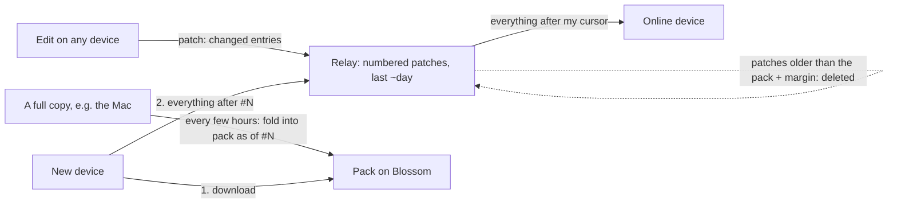

# State objects: stamped records, packs and a relay cursor

Status: **design; the record library exists (rollout step 3), nothing uses
it yet.** Proposed successor to the base / delta / compaction model of
`docs/state-sync.md` (which stays the contract until this ships).

## Why

A new device takes minutes to load a vault, and the time grows with the
number of objects:

- Every object is a **chain of edits** (`core/dag.odin`); its state is a
  replay of that chain. Dropping old edits needs a stand-in for them, so
  every object also has a **base** (checkpoint), and computers **compact**
  edits into new bases.
- A new device asks the relay for bases 100 objects per request
  (`HTAG_BATCH`), relay by relay, waiting for each answer (EOSE) before the
  next; then for the live deltas of those bases, again in batches; then it
  decrypts, verifies and applies every event separately. It is thousands
  of small waits and writes, not a lot of data.
- Measured on Grant's Mac (2026-10-28): 6,685 live objects, 7,748 bases
  from relays, 2,533 backfill events, 49,404 change files on disk.

At 10x the objects every one of those numbers grows 10x.

## The design in one paragraph

An object is stored as its **current state**, where every property, block
and chat message carries a **stamp** (hybrid clock time + device). Two
copies of an object merge entry by entry - the newer stamp wins - so order
and repetition do not matter and there is no history to keep. An edit is a
**patch**: just the changed entries. The relay numbers each space's events
with a **cursor**. Every few hours a full copy folds the space into a
**pack** - all records, compressed and encrypted on Blossom - "as of cursor
N", and patches older than the pack (plus a margin) are deleted. A new device
downloads the pack, then asks for "everything after N". An online device asks
for "everything after my cursor". A **fingerprint** of the space tells any
device whether it is exactly in step.



## Goals

- A new device loads any space with **one download plus one query**.
- An online device catches up with **one query per reconnect**.
- **No edit history, bases, checkpoints or compaction** to maintain.
- Same guarantees as today: end-to-end encrypted, signed by members, works
  offline, every device converges to the same state.
- Lite devices (web, iPhone) can still fetch one object without the whole
  space.

## Non-goals

- Character-level co-editing of one paragraph (no text CRDT; a paragraph is
  one entry - newer wins, as effectively today).
- Edit history or undo of other people's changes (nothing in the app uses
  the DAG for this today; confirm in the audit, phase 1).
- Files: unchanged (Blossom, `docs/state-sync.md` "Files on Blossom").

## Object records

```proto
message Stamp {
  uint64 time   = 1;   // hybrid logical clock: unix ms << 16 | counter
  uint32 device = 2;   // index into the space's device table (below)
}

message Entry {
  string key    = 1;   // property key, block id, message id
  Stamp  stamp  = 2;   // always written, even when zero
  bool   gone   = 3;   // tombstone: the entry was removed at `stamp`
  oneof body {         // a tombstone keeps an empty body of its kind
    Value       value   = 4;   // a property (existing Value message)
    BlockBody   block   = 5;
    MessageBody message = 6;
  }
}

message BlockBody {
  string   parent           = 1;   // "" = top level
  string   position         = 2;   // fractional key, sorts siblings (as pin_order)
  BlockContent content      = 3;   // existing block content (text, style, marks, ...)
  ValueMap fields           = 4;   // existing Block.fields (column width, ...)
  BlockAlign align          = 5;   // existing Block.align
  string   background_color = 6;   // existing Block.background_color
}

// Same fields as BlockBody; `content` is the existing chat block content
// (custom "chat", meta {author, ts, text, ...}).
message MessageBody { /* fields 1-6 as BlockBody */ }

message Record {
  string object_id   = 1;
  Entry  type        = 2;   // key "type": value {string_value: typeKey}
  Entry  deleted     = 3;   // key "deleted": value {bool_value}, object-level
  repeated Entry fields   = 4;
  repeated Entry blocks   = 5;
  repeated Entry messages = 6;
  int64 created_at   = 7;   // informational; merge keeps the smallest non-zero
}
```

BlockBody carries `fields`, `align` and `background_color` (not in the first
draft) because blocks have them today and a record must show the same page.

Implemented in `core/record.odin` (and `roostr-engine`), checked against the
shared vectors in `core/testdata/record_vectors/`. Details both engines fix:

- **Canonical encoding** (hashing, packs): proto3 rules (defaults omitted,
  fields in number order); entries sorted by key; every map (Value maps at
  any depth, block `fields`, custom `meta`) sorted by key, a repeated key
  keeps its last value; a tombstone's body encoded empty.
- **Merge tie**: equal stamps (never written on purpose) - the larger
  canonical Entry bytes win, so merge stays commutative.
- **View** (record → today's object JSON): live fields; blocks and messages
  form one tree, children ordered by `(position, id)`, entries whose parent
  is gone are hidden; `created_at` = the record's, else the oldest stamp;
  `updated_at` = the newest stamp, tombstones included.
- **Conversion** (`record_from_object_state`): one replay of the DAG with a
  `Replay_Hook` records, per key, the last change that wrote it; a block
  counts as a message when its content is custom `"chat"`; positions come
  from `pin_key_between` by bisection over each sibling list (short keys
  for long chats); keys removed by a change become tombstones; entries
  from a checkpoint seed get its `updated_at` and device 0. The `record`
  core method exposes this to hosts without a replay (`writers`,
  `from_changes`).

- **Properties**: one entry per key. `name`, `channel`, `iconEmoji`, ... are
  properties as today.
- **Page text**: one entry per block. Order comes from `(parent, position)`;
  `position` is a fractional key (`core` already has `key_between`, used for
  pins), so two devices inserting at the same place both keep their blocks.
  Moving a block = new `parent`/`position` with a new stamp.
- **Chat**: one entry per message, keyed by message id. Messages from
  different devices never collide; editing one is a new stamp.
- **Removal** of a property, block or message is a tombstone entry
  (`gone`), so an older copy arriving later cannot bring it back.
- **Deleting the object** stamps `deleted`; restoring stamps it again.

### What the history audit requires (phase 1, 2026-10-28)

Nothing user-facing reads edit history: chat order comes from the block
tree, message ids are fixed at creation, conversation compaction is a view
over kept blocks, and undo is local. Where today's replay does more than
"newer wins", the record keeps one entry per thing:

- **`updated_at` / `created_at`** = the newest / oldest stamp in the record.
- **Conversation participants**: one entry per participant
  (`participant:<id>`), not one list - concurrent joins both survive.
- **Directory counters** stay one entry per device (`count:<type>:<device>`),
  so two devices never overwrite each other's count.
- **Block and message ids** stay fixed at creation; adding the same id twice
  is the same entry.
- **Author of a change** becomes the stamp's device; the signer check
  (`src/shared_authority.odin`) moves from changes to patches.
- The engine exists twice - Odin (`core/`) and Rust
  (`RoostrWebsite/gpui/crates/roostr-engine`, used by the web and iPhone
  replicas); both get `Record` and the merge, with shared test vectors.

### Device table

Each space keeps a small list of device ids (in its directory object,
`docs/state-sync.md` "Directories"), so a stamp stores a 2-4 byte index
instead of a 32-byte key. The patch's signer is still checked against the
device it claims (below).

### Hybrid logical clock

`time` = max(local wall clock ms, highest time seen + 1) packed with a
16-bit counter. Every device advances its clock past any stamp it receives,
so a device whose wall clock is behind still writes stamps newer than what
it has seen, and a device whose clock runs ahead cannot keep winning once
others have seen its stamps. A stamp more than 24 h in the future is
refused on arrival (reported on the device record's Error).

## Merging

For every entry key, keep the entry with the larger stamp: compare `time`,
then `device`. That's the whole rule:

- commutative, associative, idempotent - any order, any repetition, same
  result on every device;
- a tombstone is an entry like any other: it beats older edits and loses to
  newer ones;
- `type` and `deleted` merge the same way.

Merging a pack, a patch or another device's record all go through the same
function: `record_merge(a, b) -> Record`.

### What happens on concurrent edits

| Two devices at once | Result |
|---|---|
| Different properties, blocks or messages | Both kept |
| Same property | Newer stamp wins |
| Same block's text | Newer stamp wins (that paragraph) |
| One edits a block, the other deletes it | Newer stamp wins |
| Both add blocks at the same spot | Both kept, ordered by position then id |

## Patches (the wire format for edits)

A patch is the changed entries of one object:

```proto
message Patch {
  string object_id = 1;
  repeated Entry entries = 2;   // type / deleted use keys "type" / "deleted"
}
```

- One patch per object per write (a mutation touching several objects
  writes several patches). Size is proportional to what changed, not to the
  object: a chat message on a 4 MB agent object is a few hundred bytes.
- Encrypted and tagged exactly as today's deltas: NIP-44 with the personal
  conversation key or the space key; `h` = blinded object id; `s` = blinded
  space tag. New event kind (**1081**), regular.
- Signed by the writing device's key. The space's writer gate applies as
  today; a stamp whose device index does not match the signer is refused.
- Big patches (a pasted 2 MB page) are chunked with the existing `c` tag
  parts.

## Relay cursor

RoostrRelay assigns every stored event a **sequence number per stream**: a
stream is one space tag (`s`), or one author's personal events. The relay
never reads the content; it only counts.

- Stored events get `seq` (monotonic, gap-free per stream, never reused).
- New REQ filter field `after` (an integer, with exactly one `s` or one
  `authors` value): the stream's events with `seq > after`, in `seq` order,
  paged with `limit` as today.
- EOSE carries the stream's current head: `["EOSE", sub, {"head": 48231}]`
  (relays that don't know `after` ignore it, so old clients are unaffected).
- Live subscriptions deliver `seq` with each event so a device can store its
  cursor as it goes.

A device keeps one cursor per stream. Reconnecting = one REQ per stream.

## Packs

A pack is a space (or the personal stream) **as of cursor N**: every record,
tombstones included, in a fixed order.

- **Format**: a small header (`stream`, `cursor`, record count, bucket
  index) then 256 **buckets** by the first byte of `sha256(object_id)`,
  each bucket a run of length-prefixed `Record` protobufs sorted by id. The
  whole thing is compressed per bucket with zstd and encrypted with the
  existing Blossom frame format (`harness/src/blossom.ts`: AES-256-GCM,
  4 MiB frames). Per-bucket compression plus the index let a **Lite** device
  fetch one bucket with an HTTP Range request instead of the whole pack.
- **Key**: `HMAC-SHA256(space key, "roostr-pack-v1" || cursor)` (personal
  stream: the personal conversation key) - only members can read it.
- **Announced** by an addressable event (kind **31081**, `d` = the blinded
  stream tag), signed by the builder, content encrypted like a patch:
  `{cursor, sha256, size, url, root, buckets: [16 hex chars x 256],
  records, built_at, builder}`. Relays keep only the newest per stream.
- **Built** by a full copy that is a writer of the space (the space's host
  computer by default; any full copy if the host has been silent for a
  day). When: every 6 hours, or after 2,000 patches, whichever comes first;
  never while the builder is behind the stream head.
- **Retention**: after a new pack is announced, the builder deletes
  (NIP-09) patches with `seq` <= the previous pack's cursor, and the
  previous pack's blob. So the relay holds one or two packs and at most
  about one pack interval plus a day of patches.

## Fingerprints

- **Record hash** = sha256 of the record's canonical encoding (entries
  sorted by key, unknown fields dropped).
- **Bucket hash** = sha256 of its records' hashes in id order.
- **Root** = sha256 of the 256 bucket hashes.

The pack announcement carries the root and the 256 bucket hashes. A device
that has applied everything up to the pack's cursor compares: equal root -
exactly in step; otherwise it fetches only the buckets that differ (Range
requests) and merges them. Devices can also publish their root on their
device record, so "is everyone in sync?" is one comparison.

## Device flows

**New device / Lite → full**
1. REQ the pack announcement for each stream it needs (one round trip).
2. Download each pack (one HTTP GET each), verify sha256, decrypt,
   decompress, bulk-insert records in one transaction.
3. REQ `after: <pack cursor>` per stream; merge the patches.
4. Subscribe live.

**Online device reconnecting**: REQ `after: <my cursor>` per stream. If the
relay's oldest kept `seq` for the stream is above my cursor + 1 (I was away
past the window), go to "behind the window".

**Behind the window**: load the newest pack as a new device would, merging
into local state (local entries with newer stamps survive), then send
anything in the local journal.

**Offline edits**: patches go to a local **journal** (as today's pending
changes) and are sent on reconnect. Their stamps are their real (hybrid)
times, so they merge correctly however late they arrive. A patch is
removed from the journal when the relay acknowledges it (`OK`); a resend is
harmless (merge is idempotent).

**Lite device opening one object**: read the bucket index from the pack
announcement, Range-fetch that bucket, take the record, then apply patches
for that object (`h` filter, `after` the pack cursor).

## Tombstones

Tombstones are kept for **30 days**, then dropped by the pack builder. A
device away longer than that loads the newest pack and drops local entries
older than 30 days that the pack doesn't have; its journal patches older than
30 days for objects that are gone from the pack are discarded and listed on
its device record's Error ("N offline edits to deleted objects were
dropped").

## Migration

Per stream, in one direction, with no flag day for single-user spaces:

1. **Convert**: each device replays its current DAG state once into records.
   Every entry's stamp = the time of the change that last wrote it (`device`
   = that change's author). Same state on every device because replay is
   deterministic.
2. **First pack**: the host builds pack #1 from the converted records and
   announces it with cursor 0 (the relay's first `seq` for the stream).
3. **Switch**: a space switches when every device record in it reports the
   new version (devices already publish their version). Until then, devices
   keep today's protocol. A device that sees a space switched but runs the
   old version shows "Update Roostr to keep syncing this space".
4. **Cleanup**: once switched, the host deletes the space's bases, deltas
   and checkpoints from the relays (NIP-09) and devices delete `bases/`,
   `changes/`, `checkpoints/`, `folded/`.

## Engine changes (`core/`)

| Today | After |
|---|---|
| `dag.odin` (Kahn sort, replay), `replay.odin`, checkpoints, bases, epochs, covered ids, compaction | `record.odin`: `Record`, `record_merge`, `record_apply_patch`, canonical hash |
| Mutations append changes to the DAG | Mutations produce `Patch`es, merged into the local record |
| `Object_State` built by replay | `Object_State` = a view of the record (unchanged API for queries) |
| Store keeps changes per object | Store keeps one record per object plus the journal |

Queries, the JSON API and the app's object model don't change shape. The
same change lands in the Rust engine (`roostr-engine`: `replay.rs`,
`codec.rs`), checked against the Odin one with shared test vectors.

## Estimates

Measured on Grant's Mac, 2026-10-28: all 6,685 live objects read through the
engine's API as JSON (an upper bound on the protobuf size - protobuf is
usually 40-60% of JSON before compression; compressed sizes are close).

**Size today**

| Space | Objects | Raw (JSON) | Pack, compressed (zstd) |
|---|---|---|---|
| Matcherino | 1,288 | 27.5 MB | ~2.0 MB |
| Grant Private | 3,542 | 12.8 MB | ~2.3 MB |
| Viv | 246 | 5.6 MB | ~0.3 MB |
| Farwell Castle | 761 | 2.6 MB | ~0.5 MB |
| Five small spaces | 812 | 2.0 MB | ~0.4 MB |
| **All** | **6,685** | **50.7 MB** | **5.4 MB (zstd -19) to 7.2 MB (zstd -3)** |

- Stamps add about 96k entries x ~10 bytes = ~1 MB raw, ~0.5 MB compressed.
- Half the bytes are chat: the 10 largest objects (agents and long tasks
  with long chats) are 17% of the vault; the biggest, one agent, is 4.3 MB.
  The median object is 1.1 KB.
- **Pack for the whole vault: ~6-8 MB.** At 10x objects: **~60-80 MB**.

**Storage**

| | Today | After |
|---|---|---|
| This Mac's sync data (`~/.glon`) | ~350 MB on disk: bases 114 MB, changes 201 MB (49k files, 31 MB of data), checkpoints 16 MB, folded 18 MB | ~30-50 MB of records + the journal |
| Relay | 7,748 bases + live deltas (≈ the Mac's 114 MB of bases, plus base64) | ~6-8 MB of packs (one or two per space) + about a day of patches |

**New device, full sync (estimates, not measured)**

| Step | Today's vault | At 10x |
|---|---|---|
| Find packs | 1 round trip | 1 round trip |
| Download | 7 MB: ~0.6 s at 100 Mbit/s, ~3 s at 20, ~11 s at 5 | 70 MB: ~6 s, ~28 s, ~2 min |
| Decrypt + decompress | <0.2 s native, ~0.5 s browser | ~1-2 s native, ~3-5 s browser |
| Write to the store (one transaction) | ~0.5 s native, ~1-3 s browser | ~5 s native, ~10-30 s browser |
| Catch up after the pack | 1 query, under 1 s | 1 query, under 1 s |
| **Total** | **~2-5 s on good Wi-Fi, ~15 s on slow mobile** | **~15-45 s on good Wi-Fi** |

Today's path is hundreds of round trips plus thousands of separate writes
before any of that; the user-visible time is minutes.

**Online device reconnecting**: one query per stream, returning only what
changed - typically well under a second.

**Lite device opening one object**: one Range request for its bucket
(~1/256 of the pack: ~30 KB today, ~300 KB at 10x) plus one patch query.

## Rollout

1. **Audit** what reads DAG history (heads, change ids, `covered_ids`) in
   core, daemon, harness, replicas and app; confirm nothing user-facing
   needs it.
2. **Relay cursor** (RoostrRelay): `seq`, `after`, EOSE head. Backward
   compatible; test against a local relay first.
3. **Engine**: `Record`, merge, patches, hash; conversion from DAG state;
   tests that merge converges under shuffled and repeated input.
4. **Packs**: builder (harness), loader (daemon, web and iOS replicas),
   fingerprints, Lite bucket fetch.
5. **Switch per space** as devices update; delete legacy events.
6. **Remove** DAG replay, bases, checkpoints, compaction and their code.

## Open questions

- Pack interval: 6 h / 2,000 patches is a starting point; tune after
  measuring patch volume per space.
- Who builds the personal stream's pack when no computer is online for
  days (only browsers and phones)? Proposal: any full copy may, including a
  browser with a full replica; the newest announcement wins.
- Whether to keep a short **local** history per object (last N patches) for
  a future "what changed" view. Cheap, never synced.
